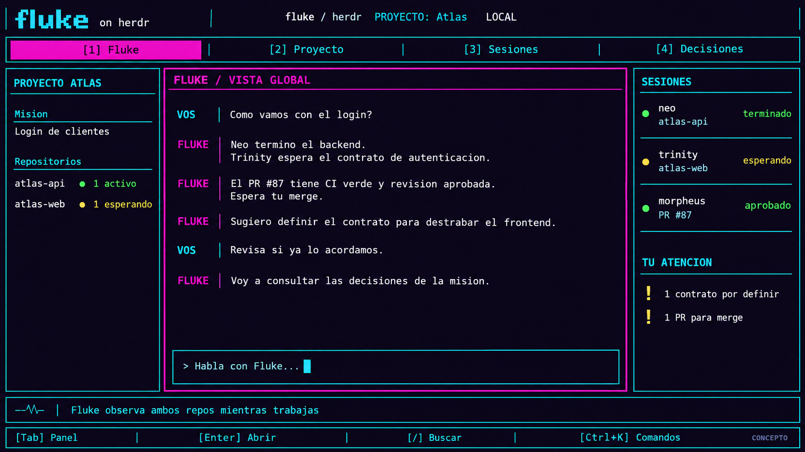
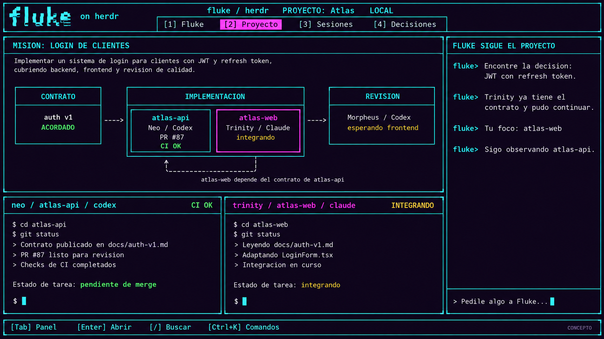
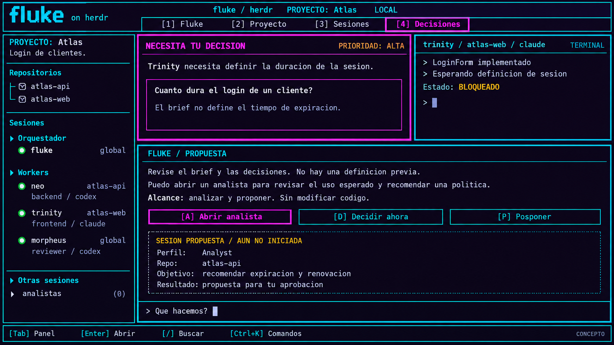

# Dirección visual acordada

Estado: dirección confirmada por el usuario el 2026-10-07.

Los tres mockups de Fluke sobre Herdr son el objetivo visual y de composición
del producto. La implementación debe avanzar hacia esa experiencia. Los textos,
datos y funciones puntuales de las imágenes se adaptan a la spec vigente.

## Referencias

### Vista global

Conversación con Fluke como foco principal. Contexto del proyecto a la izquierda;
sesiones y atención pendiente a la derecha. Entrada de conversación visible.

### Proyecto y sesiones

Plan y dependencias del proyecto junto a terminales de workers. Fluke permanece
accesible mientras el usuario trabaja con sesiones. Cada proyecto es un repo,
según la decisión vigente; el ejemplo de dos repos en esta imagen se adapta a
tareas distintas del mismo proyecto.

### Decisiones

Pregunta pendiente, contexto, sesión afectada y propuesta de Fluke en la misma
vista. Acciones identificadas por teclado. La propuesta de un analista/perfil
del ejemplo se reemplaza por el modelo vigente de un worker por tarea.

## Rasgos que deben conservarse

- Estética de consola/BBS de los 90, con tipografía monoespaciada y alineación
  por celdas.
- Fondo casi negro con matiz violeta, cian para estructura y magenta para foco.
  Verde para resultados satisfactorios y ámbar para espera o atención.
- Bordes rectos de terminal, separadores y paneles con jerarquía clara.
- Navegación conceptual: Fluke, Proyecto, Sesiones y Decisiones.
- Atajos visibles y operación mediante teclado.
- Conversación, plan y terminales conviven; el orquestador sigue accesible
  desde el trabajo concreto.
- Texto nítido y legible. El neón no debe dificultar leer código o estados.
- Las vistas se adaptan a terminales pequeñas conservando su jerarquía y
  ofreciendo acceso a los paneles, sin exigir mostrar todo simultáneamente.

## Criterio de implementación

Cada incremento de interfaz debe compararse con estas referencias en términos
de composición, color, densidad, foco y navegación. La revisión visual se hace
con capturas reales del producto.

La interfaz será propia. Herdr puede aportar referencias o código puntual,
sin condicionar la composición acordada. Las pantallas tempranas pueden ser
parciales, siempre que su evolución mantenga esta dirección.

La implementación vigente está en `tools/fluke-console-go`. La pantalla se
organiza alrededor del objetivo acordado y la conversación con Fluke: el plan
muestra las tareas, la ejecución de workers y las entregas para revisión. Las
sesiones conservan acceso directo y ventanas propias. Cabecera y pie tienen
marcos de consola, títulos diferenciados y foco magenta; los textos usan
alineación y ajuste por palabras. No hay renderizador gráfico ni animación
permanente añadida.

Las capturas `go-*.png` provienen de la app Windows con repos y procesos de
prueba. Las `go-live-*.png`, cuando se genera la prueba opcional, renderizan
las vistas del mismo modelo de interfaz sobre sesiones de IA reales mediante
el runtime propio; se distinguen de las capturas externas del ejecutable.
Los estados y resultados son observables. La coordinación inicial mediante
órdenes y reportes está conectada; no se dibuja un grafo de dependencias que
el runtime todavía no ejecuta.
